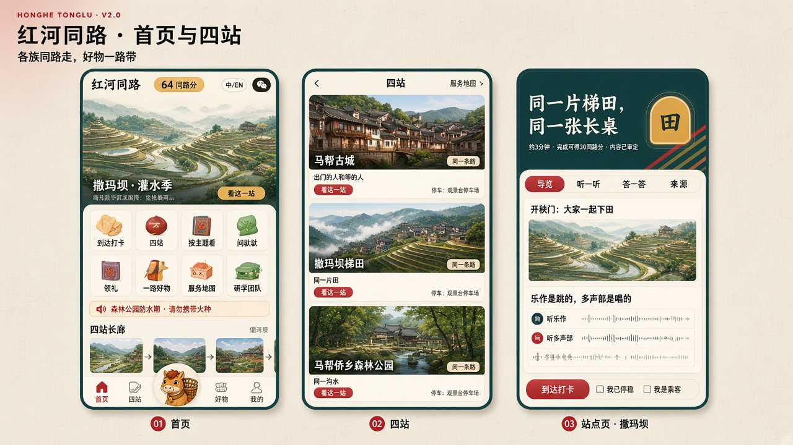
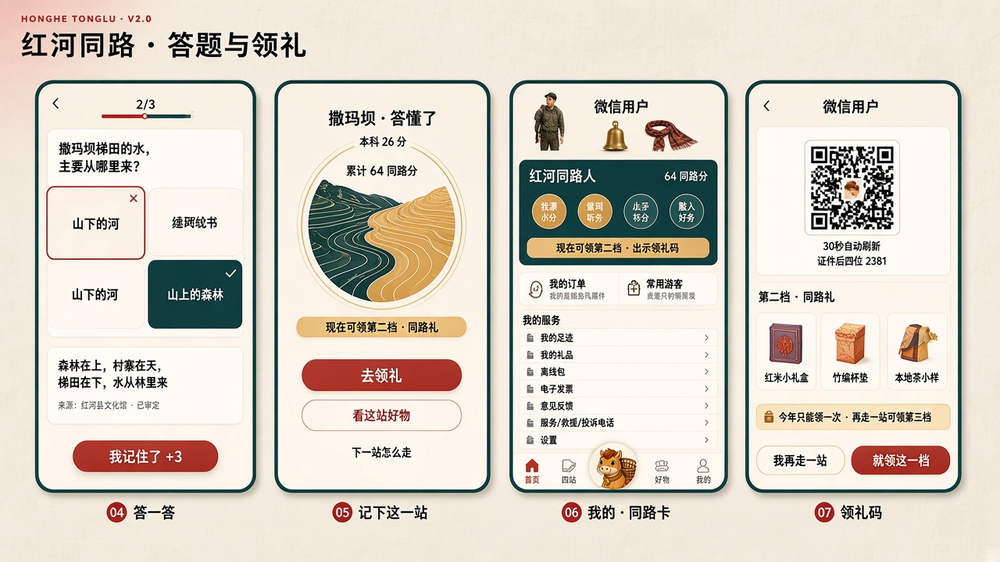
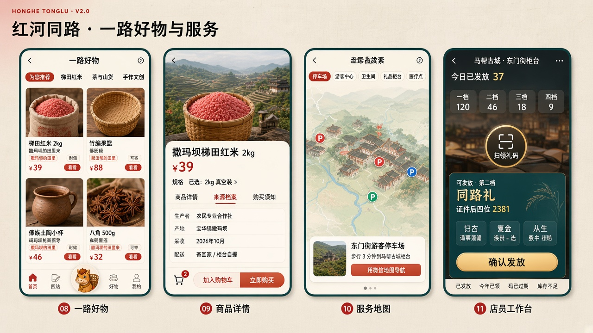
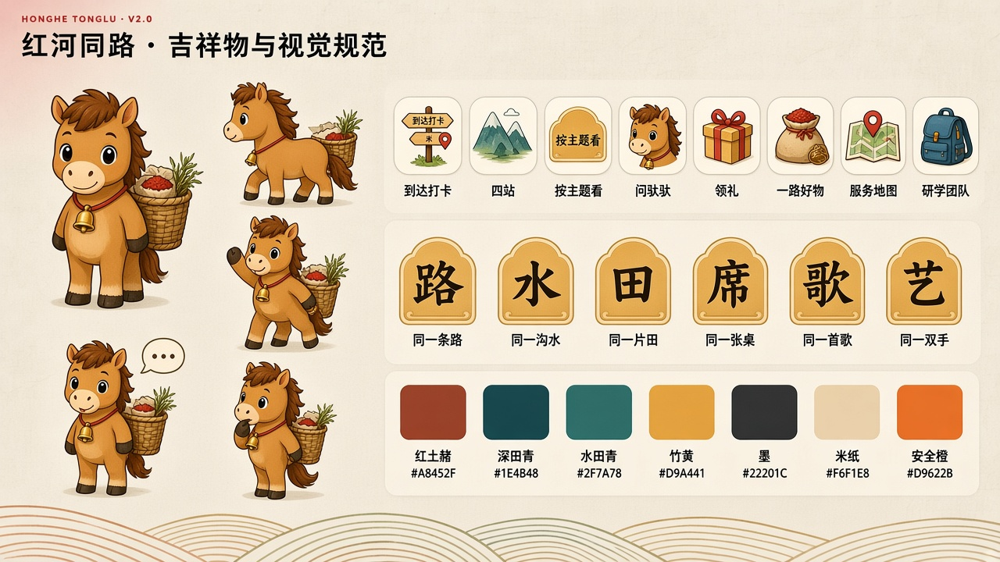

# 红河同路 · 参考借鉴与 v2 优化方案

> 版本 v2.0 · 在 v1.1（内容文档、UI 交互设计、政策对照审查）基础上修订
> 依据：用户提供的 8 张参考图（京西旅游小程序首页 / 资讯推荐 / 目的地 / 商品详情，香山公园首页 / 地图导览 / 我的，「红河同心游 · 文化探索与民族认识 v3.3」设计板）
> 本文件只写「v2 改了什么、为什么改、改成什么样」。未提到的规则仍以 01、02、03 号文件为准。

---

## 0. 一句话结论

v1.1 的内容和规则是对的，但界面结构偏「自成一套」：三个标签、长廊示意图当首页、店员模式藏在「我的」、AI 放在二期且没有入口。游客打开文旅小程序时，脑子里的样子已经被京西、香山这类产品定型了：**顶部大图 + 一排图标 + 公告 + 目的地卡片 + 推荐好物，底部五个标签，中间一个吉祥物**。v2 把这套大家熟悉的骨架拿过来，把红河同路的四站流程、礼品规则和文化边界装进去。

---

## 1. 八张参考图逐张拆解

### 1.1 每张图拿什么、不拿什么

| # | 参考图 | 值得借（照搬或改造） | 不拿 / 要改的地方 | v2 落点 |
|---|---|---|---|---|
| 1 | 京西 · 首页 | 顶部插画大图 + 「立即预定」按钮；2×4 插画风图标宫格（金刚区）；单行滚动公告；底部 5 标签，中间是凸起的吉祥物按钮 | 大图是订房广告，红河首页不放商业广告；「AI 大福」可以随便问，红河的 AI 只能复述已审定内容 | 首页骨架、金刚区、公告条、中间「问驮驮」 |
| 2 | 京西 · 资讯与推荐 | 「标题 + 副标题 + 查看更多」的区块头；一大两小的资讯拼图；双列商品卡（图、名、一句卖点、两个标签、价格、按钮） | 「招商引资」这类面向政府的栏目不该放游客首页；「立即购买」直接从首页跳支付太急 | 首页「这季在红河」拼图、「一路好物」双列卡 |
| 3 | 京西 · 目的地 | 整幅插画大卡 + 左上角主题角标 + 名称 + 一句话 + 右侧「点击前往」按钮，一屏 2.5 张，好扫 | 「点击前往」在红河不能等于导航进山；顺序暗示先后 | 「四站」标签页的站点卡；按钮改为「看这一站」 |
| 4 | 京西 · 商品详情 | 大图、价格行、规格选择、「商品详情 / 预订须知」页签、底部「购物车 + 加入购物车 + 立即购买」三段式 | 原价划线与现价相同（¥199 划 ¥199）、「0 人已购买」，都是反面例子；图片是随手拍的纸箱 | 商品详情页：加「来源档案」页签，销量少时不显示，价格只写一个 |
| 5 | 香山 · 首页 | 中文 / English 切换胶囊；五个线性图标「研学活动 / 景区公告 / 开放时间 / 地图导览 / 红游香山」，下方一颗大的主按钮「在线购票」；「景区公告」「热门景点」区块 | 公告、开放时间做成图标后点进去才能看，信息藏太深；首页大面积空白 | 首页把「今日开放 / 公告」直接摊开一行；研学入口进金刚区；语言切换放右上角 |
| 6 | 香山 · 地图导览 | 顶部筛选标签「景点 / 大门 / 商店 / 卫生间 / 游客中心 / 停车场 / 餐厅」，底部浮卡「名称 + 一句话 + 导航按钮」 | 红河四站相隔几十公里山路，不做站与站之间的导航；不在梯田田埂上画线路 | 「服务地图」：只标停车场、游客中心、卫生间、礼品柜台、补给、医疗点；导航只交给微信地图开到停车场 |
| 7 | 香山 · 我的 | 头像登录；两张大卡「我的订单 / 常用游客」；「我的服务」列表（打卡、电子发票、意见反馈、服务救援投诉电话、设置） | 无 | 「我的」页几乎照搬结构，把「常用游客」用于实名领礼和团队；救援电话放进来 |
| 8 | 红河同心游 v3.3 设计板 | 深青底主题大卡 + 金色圆角「字牌」（衣 / 语 / 乐）+ 斜向彩条；页签「导览 / 文化内容 / 互动体验 / 来源审核」四层；「本次约 3 分钟 · +40 学分」；「一次只学一个重点」；关系图「同一个集市 / 同一片山水 / 同一条古道」；右上角积分胶囊 | 「按民族认识」入口、五个民族各一页、民族字牌（哈 / 彝）——这正是 v1 约束里不做的「民族图鉴」；「一句问候」要用族语，未审定不能上 | 现场页结构、来源审核页签、关系图（中心换成「一件事」而不是「一个民族」）、首页积分胶囊 |

### 1.2 第 8 张图为什么只借结构

这张设计板和我们是同一个县、同一个题目，做得也最细，所以最需要讲清楚取舍：

- **借**：四层结构（看什么、内容、怎么互动、内容从哪来），每个主题回答四个问题，这和 v1 的「每站五步 + 审定记录」完全对得上，而且把「来源审核」做成游客看得见的页签，比 v1 只在后台留审定记录更好。
- **借**：「从兴趣进入」。游客不一定按站走，有人就是想听歌、想看绣花。v2 增加「按主题看」，作为四站之外的第二条进入方式。
- **不借**：「按民族认识」和五个民族页。按民族分栏，游客得到的是「哈尼族＝梯田、彝族＝乐作」这种标签，恰好违背「各族共同创造」的主题；乐作本身就是哈尼族、彝族世代相传的。v2 的主题以**一件事、一样东西**命名，每个主题里写清楚「这件事里有哪些人」。
- **改**：关系图的中心从「哈尼族」改为「一件事」，例如中心是「撒玛坝梯田」，四周是「开田的人 / 管水的人 / 来帮工的邻村 / 来买红米的人」。图的意思从「这个民族和别人有什么关系」变成「这件事是大家一起做成的」。

---

## 2. v1.1 里需要优化的地方

下表是对照小程序常见做法和游客使用习惯后，v1.1 里不合适、不顺手的地方。

| # | v1.1 的做法 | 问题 | v2 改为 |
|---|---|---|---|
| 1 | 底部三个标签「长廊 / 一路好物 / 我的」 | 「长廊」不是常用词，游客不知道点进去是什么；订单、AI、地图都没有一级入口 | 五个标签：**首页 / 四站 / 问驮驮（中间凸起）/ 好物 / 我的** |
| 2 | 首页只有长廊示意图 + 一个「我已停好，打卡」按钮 | 第一次打开、还在家里做攻略的人，看到的是一个用不上的按钮；首页信息太少 | 首页按「我在哪」变化：不在任何站附近时，首屏是季节大图和四站；在站点范围附近时，首屏浮出「到了，打个卡」大按钮 |
| 3 | 首页「不放广告」 | 没有大图，首页像工具，不像文旅产品 | 允许首页大图，但**只放三类**：季节（灌水季 11 月–次年 4 月）、县里正式发布的活动（开秧门、姑娘节、星光夜市）、站点开放提醒；不放商家广告，不放外链 |
| 4 | 「到达确认」叫法 | 游客熟悉的词是「打卡」 | 按钮叫「到达打卡」；规则不变：点了才取一次定位，不后台定位；先勾「我已停稳 / 我是乘客」 |
| 5 | 进入就要登录 / 实名的倾向不清楚 | 微信规定不能强制授权才让浏览；也劝退做攻略的人 | 浏览、听、看全部免登录；**打卡、答题记分时才要微信登录；领礼时才要实名**；下单时才要收货地址 |
| 6 | AI 讲解员放二期且无入口 | 游客已习惯「问一问」；但又不能让 AI 乱答 | 一期就有「问驮驮」，但一期它只是**已审定问答的检索**：只回答库里有的问题，答案下方标来源；库里没有的，回答「这个问题还没有审定过的说法，可以问柜台工作人员」。二期再接大模型改写，仍只复述审定内容 |
| 7 | 商城「按站看」为主 | 买东西的人先想的是「买什么」，不是「在哪站」 | 好物页默认「为您推荐」双列卡，顶部分类「梯田红米 / 茶与山货 / 手作文创 / 按站看」；商品卡角标保留「撒玛坝的田里来」这种出处 |
| 8 | 只有「立即购买」 | 一路走四站，游客会想最后一起寄 | 加购物车；底部三段式「购物车 / 加入购物车 / 立即购买」；寄回家和柜台自提一单里都能选 |
| 9 | 店员模式藏在「我的」最底部 | 店员上岗每天都要用，找入口慢；游客也会误点 | 店员用**同一个小程序**，但绑定后「我的」顶部直接出现「切到店员工作台」；未绑定的人完全看不到。核销页是独立的全屏工作台，配色换成深底，和游客端一眼区分 |
| 10 | 称号、礼品、领礼码分散 | 游客问的就一件事：「我现在能领什么」 | 「我的」顶部一张「同路卡」：称号 + 同路分 + 四个站点徽记 + 「现在可领第 X 档」按钮，一点就出领礼码 |
| 11 | 没有地图 | 游客最常问「停车场在哪、厕所在哪、柜台在哪」 | 「四站」页右上角「服务地图」，按香山的筛选标签做；只标服务点，导航交给微信地图 |
| 12 | 公告、开放时间分散在各站页 | 防火期、望江亭建设中、雨季滑塌提示，游客到了才看到 | 首页一行公告滚动条 + 「今日开放」一行；森林公园防火期公告**置顶且不能关** |
| 13 | 离线包在首页 | 不是每个人都需要；占首页位置 | 首次进入任何站点页时提示一次「下载这站离线包（约 xx MB）」；统一管理放「我的 → 离线包」 |
| 14 | 外语：只写「预留」 | 华侨和外国游客没有入口 | 右上角「中 / EN」胶囊；一期 EN 只覆盖导览标题、安全提示、礼品规则；文化正文仍是普通话，标「English version under review」 |
| 15 | 答题错了得 3 分 | 规则对，但界面上「错了也有分」不直观，容易被理解成随便点 | 答错后先翻出讲解卡，看完讲解按钮才变成「我记住了 +3」；答对是「答对了 +10」 |
| 16 | 结果页「记下这一站」 | 和下一步衔接弱，游客不知道接下来干嘛 | 结果页给三个明确出口：**领礼（如已够档）/ 看这站好物 / 去下一站怎么走（只给距离和停车点，不导航）** |

---

## 3. v2 信息架构

```
红河同路（v2）
├── 首页
│   ├── 顶栏：品牌字标「红河同路」· 同路分胶囊 · 中/EN
│   ├── 大图轮播（季节 / 官方活动 / 开放提醒，最多 3 张，不放广告）
│   │   └── 在站点附近时，大图下方浮出「到了，到达打卡」主按钮
│   ├── 金刚区 2×4（插画图标）
│   │   到达打卡 · 四站 · 按主题看 · 问驮驮
│   │   领礼 · 一路好物 · 服务地图 · 研学团队
│   ├── 公告滚动条（防火期置顶）+ 今日开放
│   ├── 四站长廊（横滑插画卡，可顺可逆，无编号）
│   │   └── 只走两站？马帮古城 + 撒玛坝梯田（软推荐）
│   ├── 这季在红河（一大两小拼图：开秧门 / 星光夜市 / 村长有请，真实活动才出）
│   └── 一路好物 · 为您推荐（双列 4 件，查看更多）
├── 四站
│   ├── 站点大卡 ×4（插画、主题角标、一句话、「看这一站」）
│   ├── 右上角：服务地图
│   └── 站点页（每站一页）
│       ├── 页签：导览 / 听一听 / 答一答 / 来源
│       ├── 到达打卡（底板）
│       ├── 答题 → 结果（三个出口）
│       └── 这站的好物
├── 问驮驮（中间凸起按钮）
│   ├── 常见问题（按站分组，已审定）
│   ├── 输入框：只在审定库里检索
│   └── 每个答案下方：来源单位 · 审定日期
├── 好物
│   ├── 分类：为您推荐 / 梯田红米 / 茶与山货 / 手作文创 / 按站看
│   ├── 商品详情（商品详情 / 来源档案 / 购买须知）
│   ├── 购物车
│   └── 下单（寄回家 / 柜台自提 / 营地自提）
└── 我的
    ├── 头像（中性旅人 + 已得配饰）· 微信登录
    ├── 同路卡：称号 · 同路分 · 四站徽记 · 现在可领第 X 档 →
    ├── 两张大卡：我的订单 / 常用游客（实名 · 同行人 · 团队）
    ├── 我的服务：我的足迹 · 我的礼品 · 离线包 · 电子发票 · 现场礼仪 ·
    │            意见反馈 · 服务 / 救援 / 投诉电话 · 关于与审定单位 · 设置（字号 / 语言）
    └── 切到店员工作台（仅绑定店员可见）
        ├── 扫领礼码
        ├── 核销结果（8 种状态，同 v1.1）
        └── 今日发放记录 · 库存
```

### 3.1 「按主题看」：六个主题

主题以一件事、一样东西命名，不以民族命名。每个主题用 v3.3 的四层页签（导览 / 内容 / 互动 / 来源），内容全部来自四站已审定的内容卡，只是换一种排法。

| 字牌 | 主题名 | 一句话 | 内容来自哪站 | 互动 |
|---|---|---|---|---|
| 路 | 同一条路 | 马帮从这里出发，侨乡的信从这里回来 | 迤萨路口、马帮古城 | 拼一段马帮路线（示意，不是导航） |
| 水 | 同一沟水 | 森林、村寨、梯田、水系，一沟水大家轮着用 | 森林公园、撒玛坝 | 把「四素」拖到对的位置 |
| 田 | 同一片田 | 开秧门，大家一起下田 | 撒玛坝 | 看图找「哪一块田刚灌水」 |
| 席 | 同一张桌 | 长街宴，一家一桌菜，拼成一条街 | 撒玛坝、马帮古城 | 给长桌摆菜（只用审定菜名） |
| 歌 | 同一首歌 | 乐作是跳的，多声部是唱的，两件事分开听 | 撒玛坝 | 分别听乐作节拍、多声部片段（审定音频） |
| 艺 | 同一双手 | 竹编、傣族制陶、尼苏刺绣，手艺人自己讲 | 马帮古城 | 看三步工艺，认出成品 |

> 「歌」主题里，乐作和多声部是两张卡、两段音频、两道题，不合成一个「歌舞」。
> 字牌用汉字「路水田席歌艺」，**不用**「哈 / 彝 / 傣」这种民族字。

---

## 4. 关键页面 v2 说明

线框和状态细节仍以 02 号文件为准，这里只写 v2 的变化。界面效果见 `docs/images/` 下的设计图，生成用的 PROMPT 见 05 号文件。

### 4.1 首页

- **顶栏**：左侧「红河同路」宋体字标 + 小字「各族同路走，好物一路带」；右侧同路分胶囊「◆ 64 同路分」（未登录显示「登录记分」），再右是「中 / EN」。
- **大图**：插画风（不是航拍照片），第一张固定为「撒玛坝 · 灌水季」（季节外换成「稻花季」等），大图左下角一颗竹黄色按钮「看这一站」。
- **到了提醒**：只有用户主动点过一次「到达打卡」或从站点桩码进入时才出现，不靠后台定位推送。
- **金刚区**：八个插画图标，统一圆角方形底，图标内容是地方物件：路牌、四站山形、字牌、驮驮、礼盒、红米袋、地图钉、书包。
- **公告条**：喇叭图标 + 单行滚动；防火期一条为安全橙底，不可关闭。
- **四站长廊**：横滑卡，每张一幅插画 + 站名 + 一句话 + 状态（未到 / 到过 / 答懂）。卡之间用一条虚线马帮道连起来，不写 1234。
- **这季在红河**：拼图一大两小，每张左上角角标「县文旅发布」，没有正在进行的活动时整块隐藏，不放占位。
- **为您推荐**：双列商品卡，按钮是「看看」（进详情），不是「立即购买」。

### 4.2 四站页

照搬京西目的地卡：整幅插画、左上主题角标（如「同一片田」）、宋体站名、一句话、右侧按钮「看这一站」。卡片下沿多一行小字：「停车：宝华镇撒玛坝观景台停车场 · 距你 xx km」——只在用户授权过一次定位后显示距离，否则只写停车点名称。

### 4.3 站点页（以撒玛坝为例）

- 头图是深青色主题大卡（借 v3.3）：左边宋体大字「同一片梯田，同一张长桌」，右边金色字牌「田」，右下角是梯田等高线彩条（替代 v3.3 的斜彩条）。
- 大卡下一行：「约 3 分钟 · 完成可得 30 同路分 · 内容已审定」。
- 页签：**导览 / 听一听 / 答一答 / 来源**。
  - 导览：3–4 张卡，一卡一个重点（借「一次只学一个重点」）。
  - 听一听：乐作、多声部分两条音轨。
  - 答一答：3 题。
  - 来源：审定单位、传承人（经同意）、审定日期、版本号；有「我发现内容有误」入口。
- 底部固定主按钮：未打卡时「到达打卡」，打卡后「开始答一答」。
- AR 叠层入口只在撒玛坝出现，按钮文字「看看这块田一年四季」，设备不支持时直接给四张静态图。

### 4.4 答一答

- 顶部进度三个点；题目卡片在米纸底上，选项是大按钮（≥ 48pt 高）。
- 答对：选项变水田青 + 「答对了 +10」。
- 答错：选项变红土赭描边，下方翻出讲解卡（引用的内容卡标题可点回看），按钮「我记住了 +3」。
- 不出现倒计时，不出现排行榜。

### 4.5 结果页

徽记点亮动画（线描 → 填色）+ 「撒玛坝 · 答懂了」+ 本站得分 + 累计同路分 + 「现在可领第二档 · 同路礼」。三个按钮：**去领礼**（主）、看这站好物、下一站怎么走。

### 4.6 我的 · 同路卡 · 领礼码

- 「我的」结构照搬香山：头像 + 登录，下方两张大卡「我的订单 / 常用游客」，再下「我的服务」列表。
- 在两张大卡上方插入「同路卡」：深青底，左上称号「红河同路人」，右上「64 同路分」，中间四个站点徽记，底部按钮「现在可领第二档 → 出示领礼码」。
- 领礼码页：大二维码 30 秒刷新、证件后四位、档位与礼品三选一说明、「今年只能领一次，再走一站可领第三档」。亮度自动调高。

### 4.7 好物 · 商品详情

- 列表：顶部分类标签 + 双列卡。卡片：插画或实拍图、品名（宋体）、一句话出处（红土赭小字，如「撒玛坝的田里来」）、两个标签（如「耐储」「可寄」）、价格、「看看」。
- 详情：大图 → 价格行（只一个价格；销量 < 50 不显示）→ 规格 → 页签「商品详情 / 来源档案 / 购买须知」。来源档案写：生产者（合作社 / 农户 / 手艺人，经同意署名）、产地村寨、采收或制作时间、检验或标识（「红河九红」等仅在获授权时展示）。
- 底部三段式：购物车（带数字）/ 加入购物车 / 立即购买。结算页不出现任何积分字样。

### 4.8 店员工作台

- 深墨底、大号状态色块，和游客端一眼区分。
- 顶部：柜台名称 + 今日已发放数 + 各档库存。
- 中间：大号「扫领礼码」按钮。
- 结果页：8 种状态沿用 v1.1，「可发放」是水田青大色块 + 档位 + 证件后四位 + 礼品三选一，店员点选后「确认发放」；其他状态为灰或安全橙，并给出一句「可以这样跟游客说」。

### 4.9 问驮驮

- 驮驮是一匹驮着背篓的小马（马帮的马），背篓里是红米和茶。**不穿任何民族服装**，脖子上一只马铃。它是向导，不是用户自己的形象（用户形象仍是中性旅人）。
- 首屏：驮驮半身 + 「我只说审定过的事。」+ 按站分组的常见问题胶囊。
- 回答卡片底部固定一行灰字：「来源：红河县文化馆 · 2026 年审定」。
- 不回答的情况：族源、迁徙、祭祀细节、族语翻译、价格以外的商业推荐——统一回答「这个问题还没有审定过的说法」，并给「问柜台工作人员」入口。

---

## 5. 视觉系统 v2 调整

在 v1.1「红土、水田、一条路」基础上，向 v3.3 设计板和京西插画风靠拢：

| 项 | v1.1 | v2 |
|---|---|---|
| 主题大卡底色 | 水田青 #2F7A78 | 加一档 **深田青 #1E4B48**，做站点大卡、同路卡、店员工作台 |
| 主按钮 | 红土赭 #A8452F | 不变；圆角加大到 24（胶囊） |
| 强调 | 竹黄 #D9A441 | 字牌底、积分胶囊、大图按钮 |
| 页面底 | 米纸 #F6F1E8 | 不变 |
| 卡片底 | 素白 #FFFDF9 | 不变，阴影改为极淡 0 2 8 rgba(34,32,28,.06) |
| 安全 | 安全橙 #D9622B | 不变，只用于安全与防火 |
| 插画 | 线描为主 | **水彩淡彩插画**（参考京西目的地卡），四站各一幅主插画、八个金刚区图标同风格 |
| 装饰纹样 | 无 | 梯田等高线彩条（红土赭 / 竹黄 / 水田青 / 灰岩 四色细线），替代 v3.3 的斜彩条 |
| 字牌 | 无 | 金色圆角拱形牌 + 宋体单字（路水田席歌艺 / 站点用「路林城田」） |
| 吉祥物 | 无 | 驮驮（见 4.9） |

---

## 6. v2 界面设计图

由 05 号文件的 PROMPT 生成，用于评审方向和气质；**界面文字以本文件和 02 号文件为准**，图里模型写错的字在下表列出，出正式稿时修正。

| 图 | 内容 | 图中需修正的地方 |
|---|---|---|
|  | 01 首页 · 02 四站 · 03 站点页（撒玛坝） | 四站页「撒玛坝梯田」角标应为「同一片田」；站点页底部两个勾选框应合并为一个「我已停稳 / 我是乘客」 |
|  | 04 答一答 · 05 记下这一站 · 06 我的 · 同路卡 · 07 领礼码 | 答题两个错误选项文字是乱码，重复了「山下的河」；结果页「本科 26 分」应为「本站 26 分」；同路卡四个徽记里应是站名「路口 / 林 / 古城 / 梯田」；领礼码页标题应为「领礼码」 |
|  | 08 一路好物 · 09 商品详情 · 10 服务地图 · 11 店员工作台 | 服务地图页标题乱码，应为「服务地图」；店员工作台三个礼品选项文字乱码，应为「红米小礼盒 / 竹编杯垫 / 本地茶小样」 |
|  | 驮驮四种姿态 · 金刚区八图标 · 六个主题字牌 · 色板 | 「到达打卡」图标路牌上的小字去掉 |

---

## 7. v2 新增的评审项（在 02 号文件 22 项基础上）

1. 首页大图三张里有没有商家广告或外链？
2. 「按主题看」里有没有出现以民族命名的主题或民族字牌？
3. 关系图中心是不是「一件事」？
4. 问驮驮的每个答案是否都有来源行？问到不该答的是否统一拒答？
5. 浏览、听、看是否免登录？
6. 「到了提醒」是否只在用户主动操作后出现？
7. 服务地图是否只到停车场、没有站间和田间导航？
8. 商品详情是否只有一个价格、低销量不显示？
9. 店员工作台入口是否只对绑定店员可见？
10. EN 版本是否标明审核状态？
